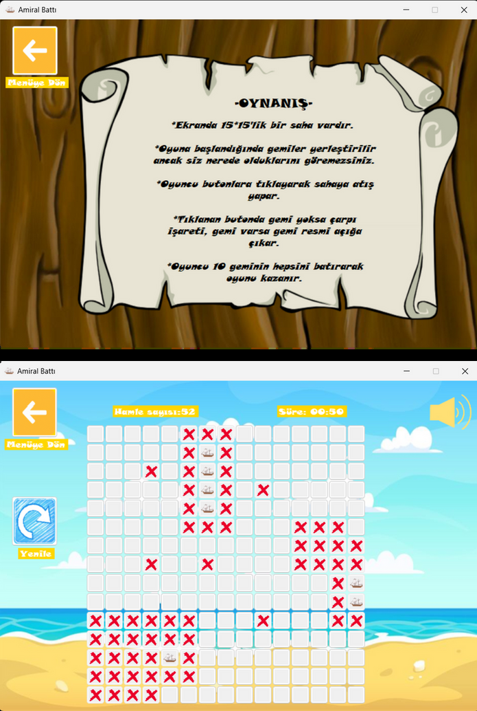

# Amiral Battı Oyunu

Windows Forms (C#) ile geliştirilmiş, **15x15 ızgara** üzerinde oynanan tek kişilik bir
Amiral Battı oyunu. Oyuna başlandığında 10 gemi ızgaraya görünmez şekilde yerleştirilir;
oyuncu kareleri tıklayarak atış yapar — gemi yoksa çarpı işareti, gemi varsa gemi görseli
açığa çıkar. Tüm gemiler batırıldığında oyun kazanılır; hamle sayısı ve süre takip edilir.

## 📸 Ekran Görüntüleri



## 🎮 Özellikler

- 15x15 tıklanabilir oyun tahtası (dinamik olarak oluşturulan `Button` ızgarası)
- 10 geminin rastgele, görünmez şekilde yerleştirilmesi
- Hamle sayacı ve zamanlayıcı (dakika:saniye), **en iyi süre** takibi
- Farklı uzunlukta gemiler — yatay/dikey yerleşim
- Oyun sonunda tebrik/üzgün görseliyle geri bildirim

## 🛠️ Teknoloji

- C# / .NET (Windows Forms)
- `System.Windows.Forms.Timer` ile süre takibi

## 📄 Dokümantasyon

- [`AmiralBAttıRaporu.pdf`](AmiralBAttıRaporu.pdf) — proje raporu

## ⚠️ Bilinen Kısıtlama

`Form1.cs` içindeki bazı görsel dosya yolları (`Image.FromFile(...)`), projenin
geliştirildiği orijinal bilgisayardaki mutlak dizin yoluna (`C:\Users\defne\Desktop\...`)
sabitlenmiş durumda. Projeyi farklı bir makinede çalıştırmadan önce bu yolların
`Resources`/`GörsellerVeSesler` klasörüne göre güncellenmesi gerekir.

## 🚀 Çalıştırma

```bash
# Visual Studio ile AMIRAL_BATTI_OYUNU_.sln dosyasını aç ve çalıştır
# veya:
dotnet run --project AMIRAL_BATTI_OYUNU_
```
